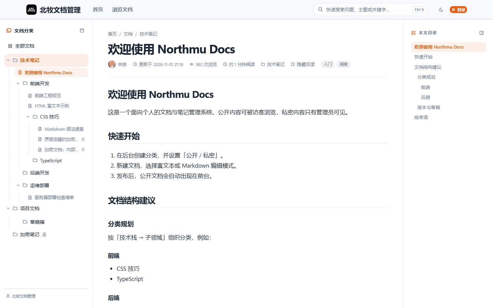

<div align="center">

# Northmu Docs

轻量个人文档 / 笔记管理系统 · Apple 风格界面 · 开箱即用

[](https://github.com/ImLinNai/Northmu_Docs/releases)
[](https://www.php.net/)
[](https://www.mysql.com/)
[](https://www.thinkphp.cn/)
[](LICENSE)

[下载发行版](https://github.com/ImLinNai/Northmu_Docs/releases) · [部署文档](DEPLOY.md) · [Gitee 镜像](https://gitee.com/imlinnai/Northmu_Docs)

</div>

## 简介

Northmu Docs 面向个人与小团队，采用「唯一超级管理员 + 访客」的轻量设计：前台展示公开文档，后台管理内容、外观与系统。安装向导七步完成部署，`vendor/` 与全部前端静态资源随包提供，**无需 Composer / Node，无 CDN 依赖**，上传即用。

## 界面预览

| 首页 | 文档页 |
| :---: | :---: |
|  |  |
| **后台管理** | **登录页** |
|  |  |

## 功能特性

**内容管理**

- 富文本 / Markdown 双模式编辑，自动草稿与版本快照、diff 对比、回滚
- Markdown / 纯文本 / HTML 文档导入，本地图片一键上传附件库
- 无限级分类、标签、附件库；分类支持折叠浏览与拖拽排序（自动保存）
- 回收站与彻底删除，操作日志全程留痕

**访问控制**

- 公开 / 加密 / 私有 三态可见性，子分类自动继承上级限制
- 加密分类整类锁定：进入分类需输入密码，解锁后分类内文档统一放行
- 加密文档独立密码，与分类密码互不影响
- 未分类文档不在前台展示，发布时编辑器会明确提示

**阅读体验**

- 三栏文档页：分类树 + 正文 + 标题目录，全文搜索（Ctrl+K）
- 列表 / 卡片视图切换，阅读进度、返回顶部、代码高亮与复制
- 亮色 / 暗色主题，6 套主题色，移动端响应式布局

**外观定制**

- 品牌信息、顶部 / 悬浮 / 胶囊三种导航、首页图片或视频背景与三套模板
- 登录页可视化配置，按钮颜色、图标与「仅图标」模式
- 公告横幅 / 弹窗、维护模式（4 套维护页模板）、纪念日全站灰度
- 音乐歌单：顶栏入口 + 播放器弹窗（封面、歌词、播放列表）

**安全与运维**

- 通行密钥（Passkey / WebAuthn）免密码登录，验证码、失败锁定、登录态时长
- 登录 / 操作审计，一键备份（SQL + 附件），在线检测更新
- Redis 内容缓存可选，缓存管理可视化
- 全站禁止复制开关、外链中转提醒

**SEO**

- sitemap、robots、canonical、Open Graph、JSON-LD 结构化数据
- 文章独立 SEO 字段与百度自动收录推送

## 项目结构

```text
Northmu_Docs/
├── app/                     应用代码
│   ├── controller/          前台、安装、SEO 控制器
│   │   └── admin/           后台控制器（文档、分类、设置等）
│   ├── middleware/          登录鉴权、维护模式等中间件
│   ├── model/               数据模型
│   └── common.php           全局助手函数
├── config/                  框架、数据库、缓存与路由配置
├── database/                安装 SQL 与版本升级脚本
├── public/                  站点根目录（Web 运行目录必须指向此处）
│   ├── static/              CSS / JS / 字体与第三方前端库
│   └── uploads/             附件与图片（安装后生成）
├── route/app.php            路由定义
├── view/                    ThinkPHP 模板
│   ├── admin/               后台页面
│   ├── doc/                 前台文档页
│   ├── index/               首页与登录相关
│   └── install/             安装向导
├── docs/screenshots/        README 截图
├── data/                    本地配置与备份（安装后生成）
├── DEPLOY.md                部署与升级说明
├── LICENSE                  MIT 许可证
└── think                    CLI 入口
```

## 快速开始

**环境要求**：PHP 8.1+（推荐 8.2）· MySQL 5.7+ · Nginx / Apache（运行目录必须为 `public/`）· Redis 可选

1. 下载 [最新发行版](https://github.com/ImLinNai/Northmu_Docs/releases/latest) 并解压到站点目录
2. 创建 `utf8mb4` 数据库
3. 访问 `http://你的域名/install`，按向导完成安装

宝塔、Nginx、Apache 的详细配置见 [DEPLOY.md](DEPLOY.md)。

<details>
<summary>本地开发</summary>

```bash
php think run -H 127.0.0.1 -p 8900
# 浏览器访问 http://127.0.0.1:8900/install
```

</details>

## 升级

覆盖程序文件（保留 `data/` 与 `public/uploads/`），按需执行 `database/upgrade_v*.sql`，清理 `runtime/cache/*` 后强制刷新浏览器。各版本差异见 [DEPLOY.md](DEPLOY.md) 与发行版说明。

## 技术栈

ThinkPHP 8.1 · think-orm · Tabler · WangEditor 5 · marked · highlight.js · diff2html · Predis

## 许可证

本项目基于 [MIT 许可证](LICENSE) 开源：你可以自由修改、分发并用于商业项目，只需保留原作者的版权声明与许可证文本。

项目内捆绑的 **ThinkPHP** 框架遵循 Apache-2.0 协议（见 `LICENSE.txt`）；`public/static/vendor/` 下的第三方前端资源遵循各自目录中的 LICENSE 文件。
