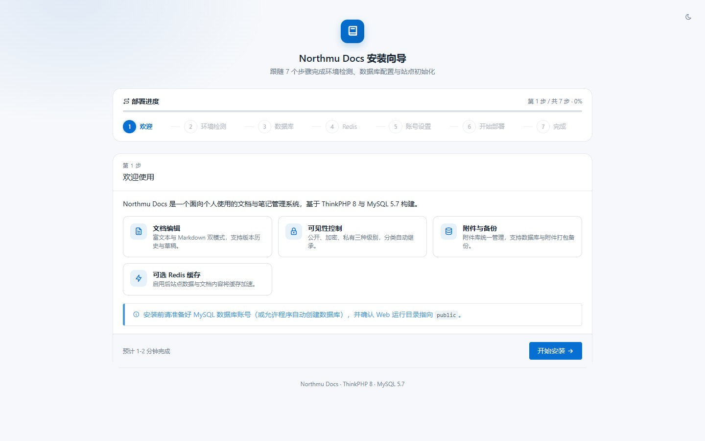
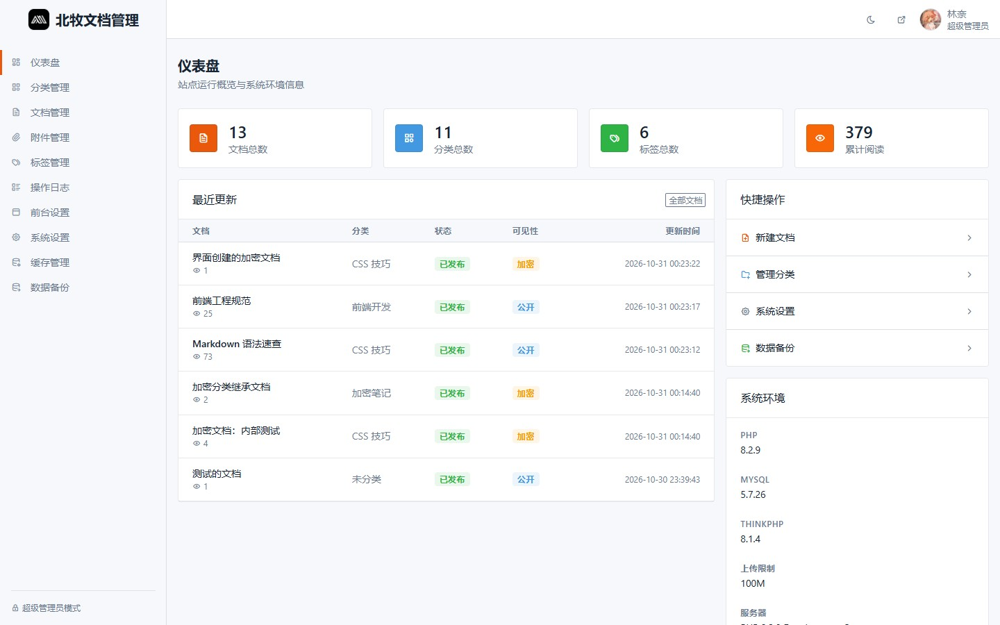

<div align="center">

# Northmu Docs

轻量个人文档 / 笔记管理系统 · Apple 风格界面 · 开箱即用

[](https://github.com/ImLinNai/Northmu_Docs/releases)
[](https://www.php.net/)
[](https://www.mysql.com/)
[](https://www.thinkphp.cn/)

[下载发行版](https://github.com/ImLinNai/Northmu_Docs/releases) · [部署文档](DEPLOY.md) · [Gitee 镜像](https://gitee.com/imlinnai/Northmu_Docs)

</div>

## 简介

「唯一超级管理员 + 访客」的轻量设计：前台展示公开文档，后台管理内容、外观与系统。安装向导七步完成部署，`vendor/` 与静态资源全部随包提供，**无需 Composer / Node，无 CDN 依赖**。

## 预览

| 安装向导 | 前台首页 |
| :---: | :---: |
|  |  |
| **后台管理** | **登录页** |
|  |  |

## 功能

**前台**

- 三栏文档页：分类树 + 正文 + 标题目录，全文搜索（Ctrl+K）
- 公开 / 加密 / 私有 三态可见性，分类自动继承
- 亮色 / 暗色主题，6 套主题色，响应式布局
- 首页图片 / 视频背景 + 三套模板；顶部 / 悬浮 / 胶囊三种导航
- 公告横幅 / 弹窗，维护模式（4 套维护页模板）
- 全站禁止复制、纪念日全站 / 首页灰度（手动或定时）
- 全站 SEO：sitemap、robots、JSON-LD、百度自动收录

**后台**

- 富文本 / Markdown 双模式编辑，自动草稿
- Markdown / 纯文本 / HTML 文档导入，本地图片一键上传附件库
- 版本快照、diff 对比、回滚、回收站
- 无限级分类、标签、附件库管理
- 品牌、导航、首页、登录页可视化配置
- 操作日志、一键备份、在线检测更新
- Redis 缓存（可选）；验证码、失败锁定、登录态时长

## 快速开始

环境：PHP 8.1+（推荐 8.2）· MySQL 5.7+ · Nginx / Apache（运行目录必须为 `public/`）· Redis 可选

1. 下载 [最新发行版](https://github.com/ImLinNai/Northmu_Docs/releases/latest) 并解压到站点目录
2. 创建 `utf8mb4` 数据库
3. 访问 `http://你的域名/install`，按向导完成安装

宝塔 / Nginx / Apache 详细步骤见 [DEPLOY.md](DEPLOY.md)。

<details>
<summary>本地开发</summary>

```bash
php think run -H 127.0.0.1 -p 8899
# 浏览器访问 http://127.0.0.1:8899/install
```

</details>

## 升级

覆盖程序文件（保留 `data/` 与 `public/uploads/`），按需执行 `database/upgrade_v*.sql`，清理 `runtime/cache/*` 后强制刷新浏览器。各版本差异见 [DEPLOY.md](DEPLOY.md) 与发行版说明。

## 技术栈

ThinkPHP 8.1 · think-orm · Tabler · WangEditor 5 · marked · highlight.js · diff2html · Predis

## 许可

基于 ThinkPHP（Apache-2.0）构建；第三方前端资源许可证见 `public/static/vendor/` 各目录的 LICENSE 文件。